# Eshop

A full-stack e-commerce platform built for the Egyptian market and designed to run on Google Cloud.

**Arabic-first with RTL** · **Paymob, Fawry & cash on delivery** · **Spring Boot · Next.js · Flutter · GKE**

---

## Contents

- [What this is](#what-this-is)
- [System architecture](#system-architecture)
- [Backend module map](#backend-module-map)
- [Request lifecycle](#request-lifecycle)
- [Database design](#database-design)
- [Key flows](#key-flows)
- [Deployment topology](#deployment-topology)
- [CI/CD pipeline](#cicd-pipeline)
- [Running it locally](#running-it-locally)
- [Layout](#layout)
- [Decisions worth knowing before reading the code](#decisions-worth-knowing-before-reading-the-code)
- [Testing](#testing)
- [Common tasks](#common-tasks)
- [Deploying](#deploying)
- [Status](#status)

---

## What this is

A production-shaped storefront, admin console, and mobile client over a single Spring Boot backend.
The decisions that shape it, a modular monolith rather than microservices, Arabic as the default
locale rather than an afterthought, and cash on delivery as a first-class payment method rather than
a bolt-on, are argued in [`docs/00-ARCHITECTURE.md`](docs/00-ARCHITECTURE.md).

| Layer | Technology |
|---|---|
| Backend | Java 21 · Spring Boot 3.5 · PostgreSQL 16 · Redis 7 · Elasticsearch 8 |
| Storefront | Next.js 15 (App Router) · React 19 · Tailwind CSS v4 · TanStack Query · Zustand · Zod |
| Admin | Next.js 15, sharing the storefront's typed API client |
| Mobile | Flutter 3 · Riverpod · go_router |
| Infrastructure | GKE Autopilot · Cloud SQL · Memorystore · Cloud CDN · Cloud Armor · Terraform |

---

## System architecture

Three clients, one API. The storefront and the admin console share a single Zod-validated API
client, so a response shape that changes breaks the build rather than a page at runtime.

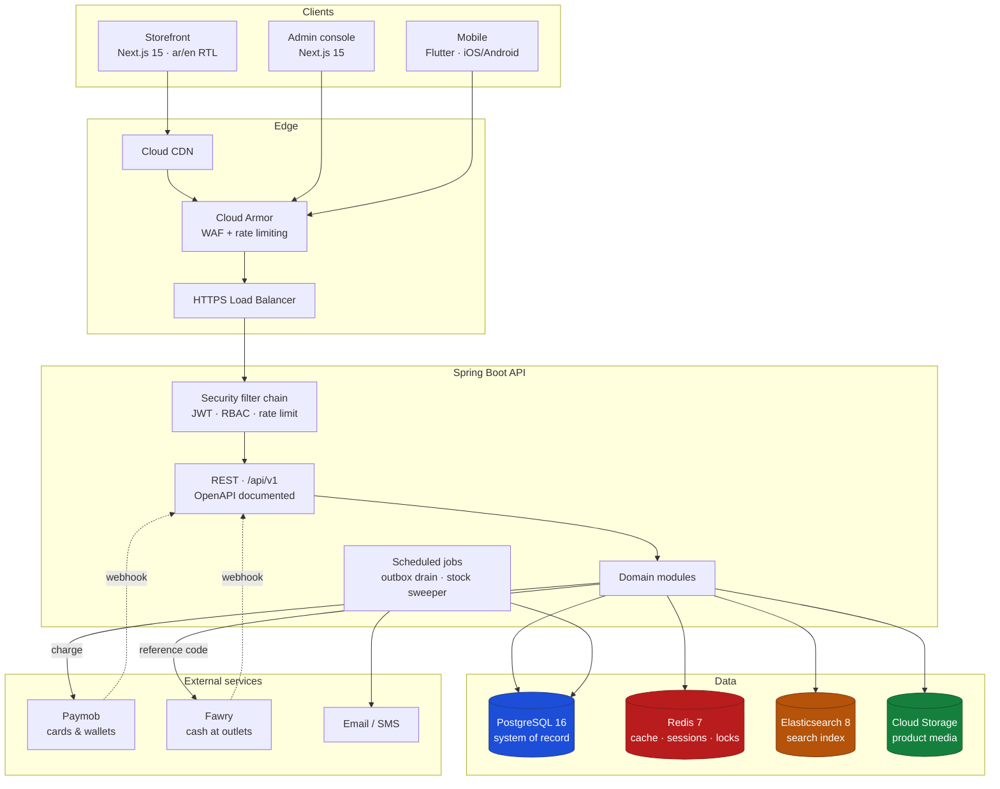

Elasticsearch is deliberately not on the critical path. It returns ids; the cards are hydrated from
PostgreSQL, so a price edit is visible immediately even while the index lags, and if the cluster is
unavailable, listings fall back to PostgreSQL rather than the storefront going down.

---

## Backend module map

A modular monolith. Each module owns its tables and exposes a service; nothing reaches into another
module's repositories. The layering rules below are enforced by ArchUnit tests, not by convention.

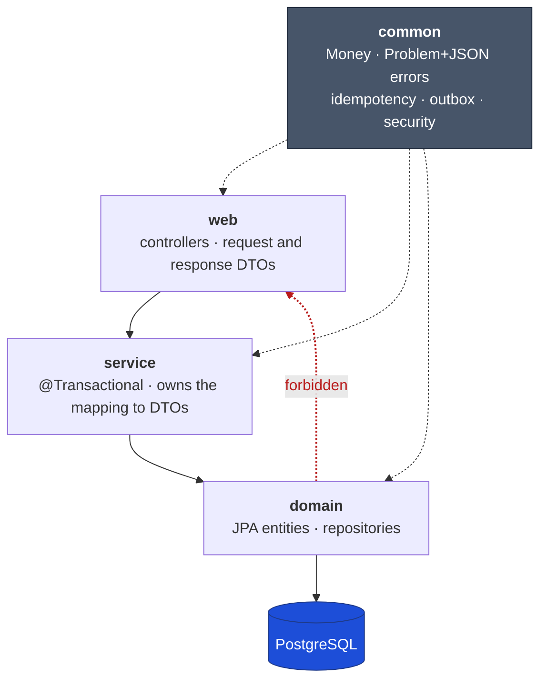

The dashed red edge is the one the ArchUnit suite exists to prevent. Two rules matter enough to be
tests:

- **No entity or repository may depend on the web layer.** A domain object that knows about a
  response DTO cannot be reused, and the dependency ends up pointing both ways.
- **No controller may inject a repository.** A controller holding a repository queries outside a
  transaction and maps the result after the session has closed. With `open-in-view` disabled that
  compiles perfectly and throws `LazyInitializationException` on every call.

And the modules themselves, with the dependencies that actually exist between them:

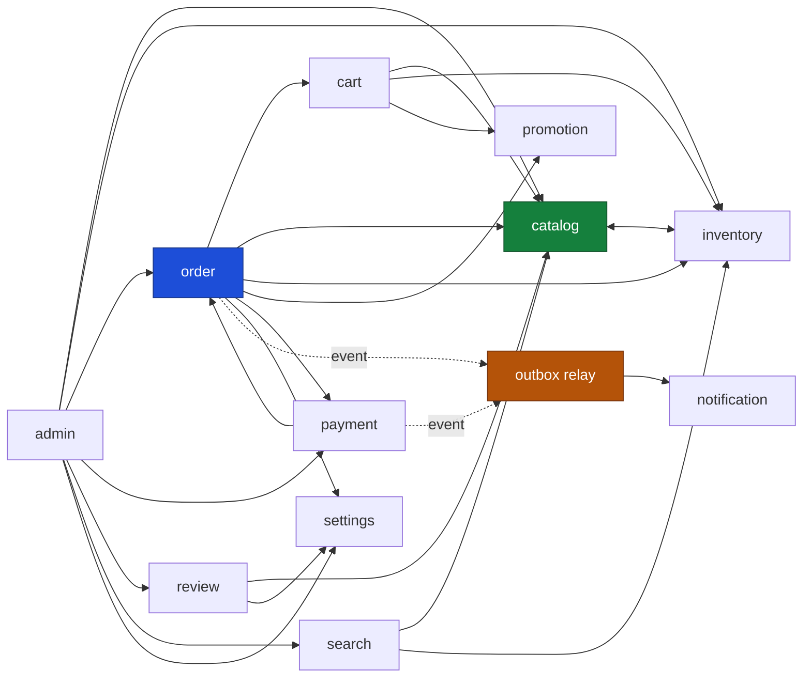

This is derived from the actual imports, not from intent. Three things it shows that are easy to get
wrong from memory:

- **`notification` has no inbound arrow from `order` or `payment`.** Nothing calls it directly.
  Events go to the outbox in the same transaction as the write, and the relay drains them, which is
  what stops a mail provider being briefly down from rolling back a captured payment.
- **`catalog` and `inventory` point at each other.** A product listing needs availability, and a
  stock row needs the product it counts.
- **`payment` and `order` also point both ways**, on purpose: an order starts a payment, and a
  captured payment moves the order.

---

## Request lifecycle

Every request passes the same chain before a controller sees it.

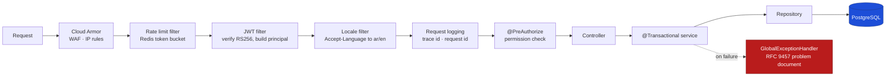

The response mapping happens **inside** the transactional service, not in the controller. That is
what keeps lazy associations reachable, and it is the reason the controller layer is as thin as it
is.

---

## Database design

PostgreSQL 16, migrated by Flyway. Roughly fifty tables across six areas. The diagrams below split
them by concern; a single diagram of the whole schema is not readable.

Conventions throughout:

- **UUIDv7 primary keys.** Time-ordered, so they index like a sequence without leaking a row count.
- **Money is `numeric(12,2)` plus a currency column.** Never a float.
- **Soft deletes where history must resolve.** `deleted_at` on products and users, so an old order
  still renders.
- **`jsonb` for shapes that genuinely vary.** Order addresses are snapshotted as `jsonb` so editing
  an address does not rewrite the delivery record of a past order.

### Identity and access

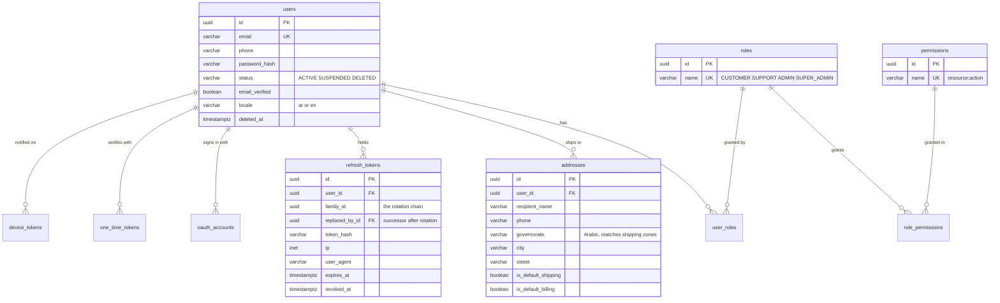

Permissions are fine-grained (`order:refund`, `product:write`) and roles are bundles of them.
Endpoints check the permission, never the role, so adding a role does not mean touching controllers.

Refresh tokens form a chain through `parent_id`. Replaying a spent token revokes the whole family,
which turns a stolen token into a detected intrusion rather than a silent one.

### Catalog

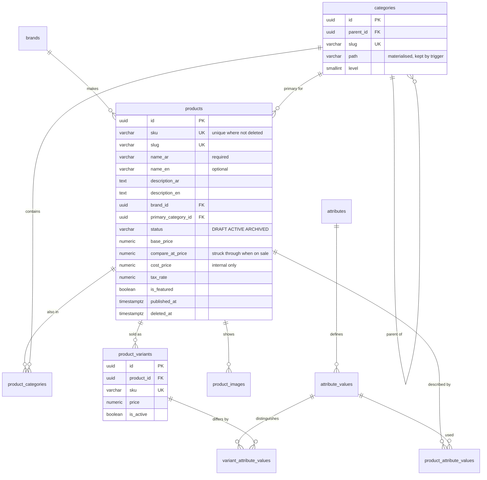

Every translatable column exists twice, `_ar` and `_en`, with Arabic required and English optional.
That is the storefront's fallback order: a product with only an English name renders as a blank tile
to an Arabic visitor, who is the default audience.

Categories carry a materialised `path` maintained by a database trigger, so a breadcrumb or a
subtree query is one indexed prefix scan rather than a recursive walk.

### Inventory

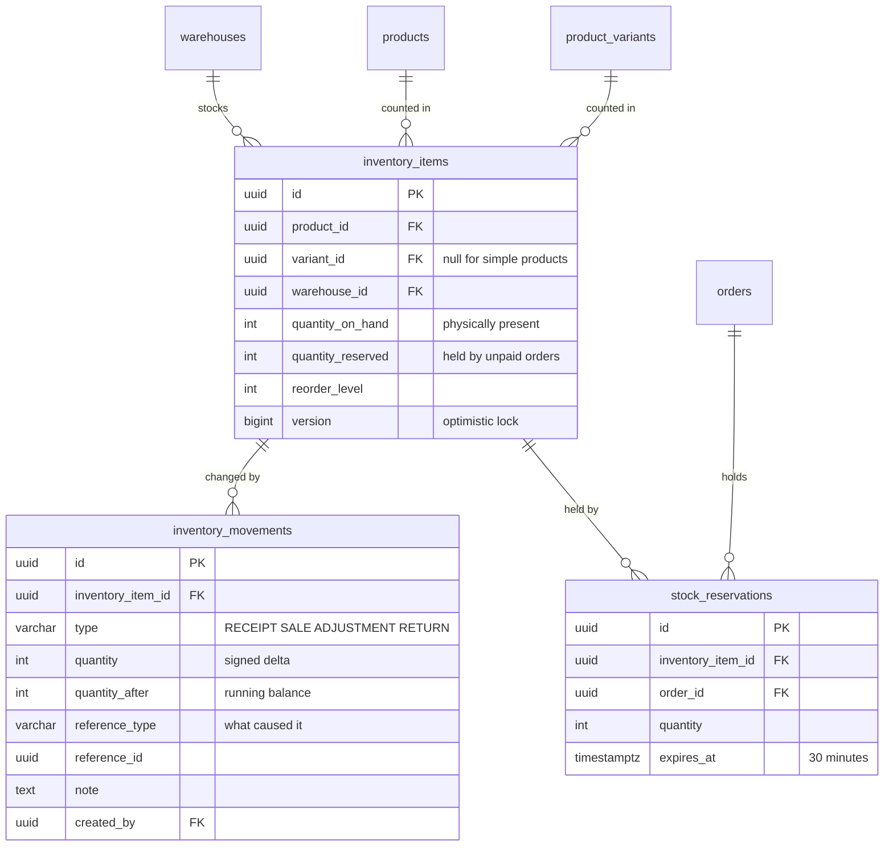

The distinction between the three numbers is the whole point:

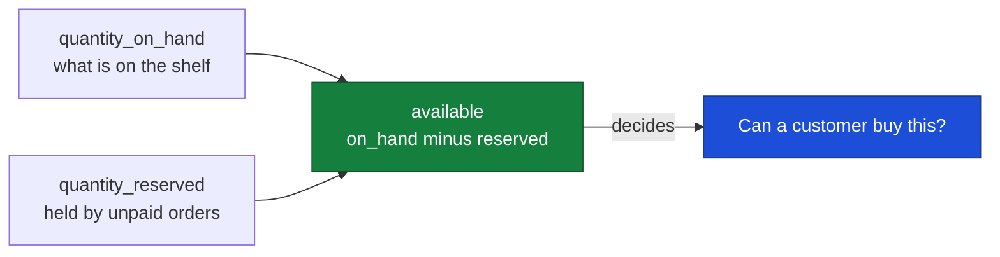

A screen or a query that reads `quantity_on_hand` alone is how a store oversells.

### Cart, orders and fulfilment

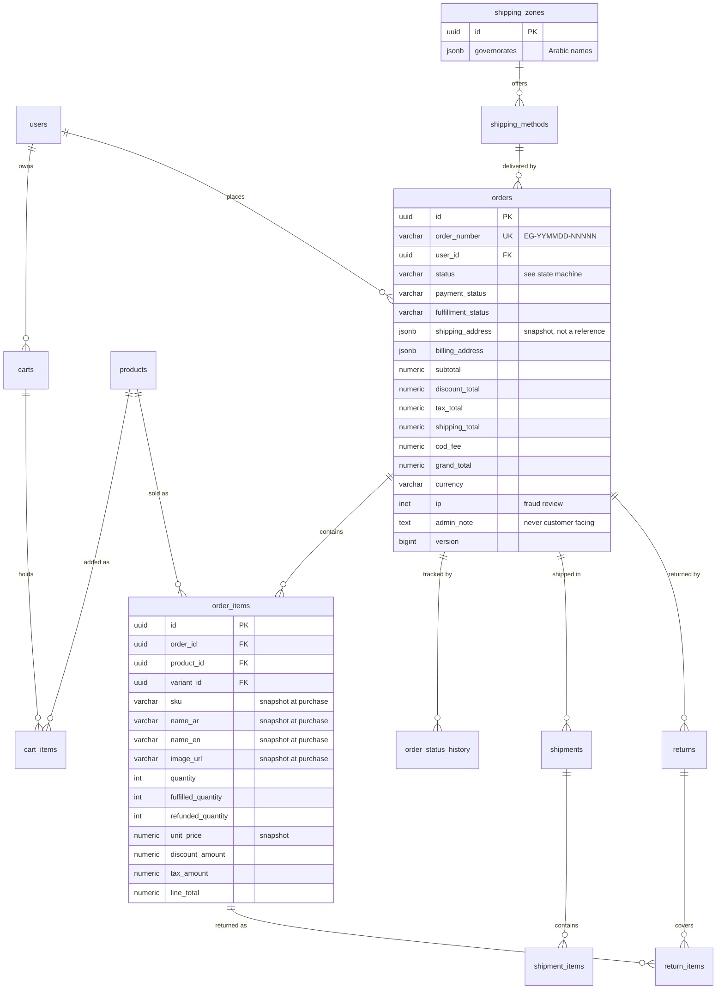

Order items snapshot the name in both languages, the SKU, the image and the price at the moment of
purchase. A product renamed, reshot or repriced next month must not rewrite what a customer actually
bought.

The shipping address is `jsonb` rather than a foreign key for the same reason. Editing a saved
address should not silently change where a past order was delivered.

### Payments and promotions

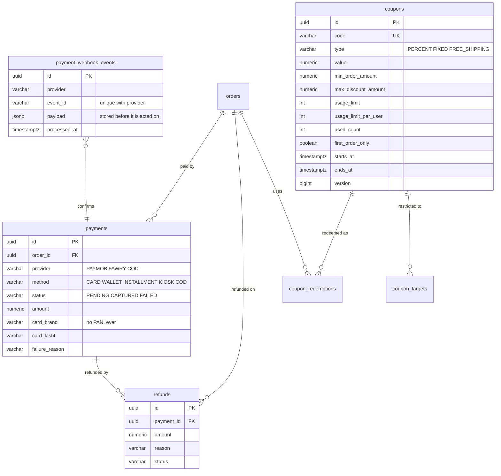

Card data never reaches this system. Paymob's iframe and Fawry's hosted flow collect the number;
what is stored is a provider id, the brand, and the last four digits.

The unique `(provider, event_id)` constraint on webhook events is the idempotency mechanism.
Providers retry aggressively, and processing a capture twice would commit stock twice and send two
confirmation emails.

### Reviews, search and operations

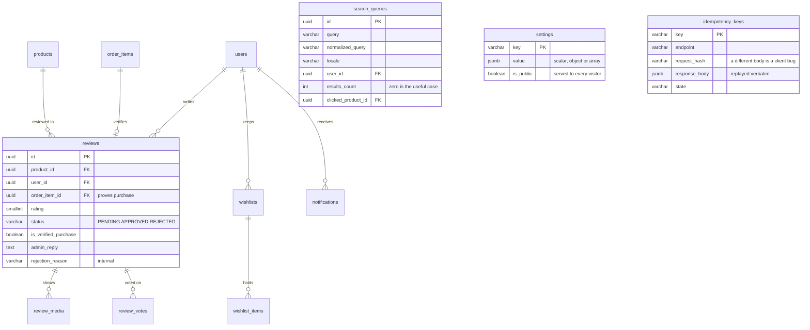

`search_queries` exists for the rows with `results_count = 0`. Every one of them is either a product
the store should stock or a word the index should recognise.

### Platform tables

These have no foreign keys into the domain on purpose. Each one has to survive the transaction it
describes, so tying it to a row that may be rolled back would defeat the point.

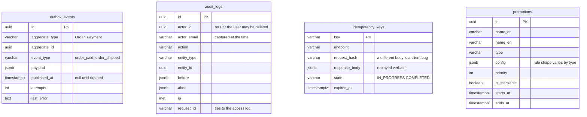

The outbox is what makes "capture the payment and send the confirmation" safe. The event is written
in the same transaction as the payment and drained separately, so an email provider that is briefly
down cannot roll back money that has already been taken.

`audit_logs` deliberately stores `actor_email` alongside `actor_id` and has no foreign key to
`users`. An audit record has to remain readable after the account it describes is deleted.

---

## Key flows

### Checkout

The single most consequential path in the system. Note where the idempotency key is claimed, and
that prices are re-read inside the transaction rather than trusted from the cart.

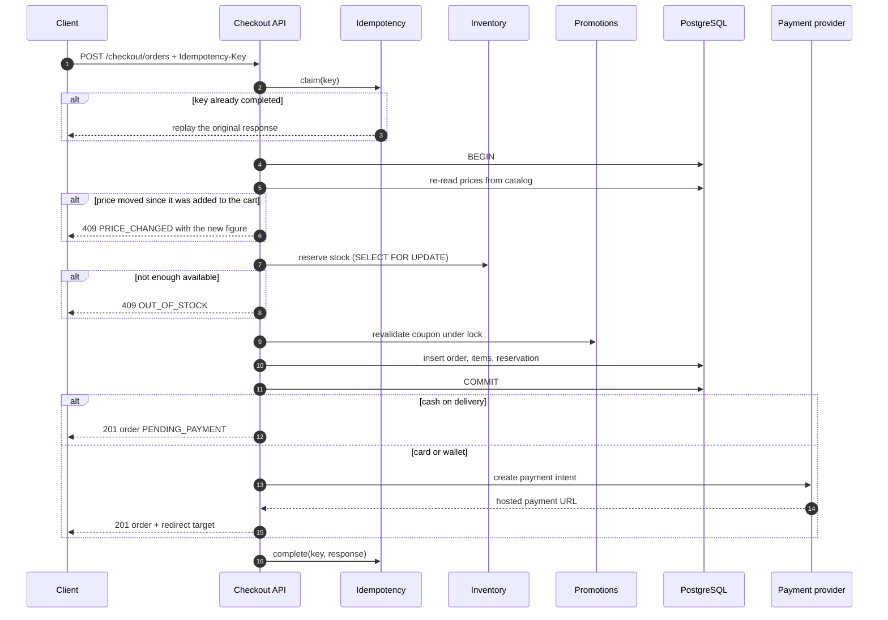

Stock is **reserved, never decremented**, at checkout. An order that is never paid must not destroy
inventory. The hold lasts thirty minutes; payment converts it into a sale, and a sweeper releases
anything abandoned.

### Payment confirmation

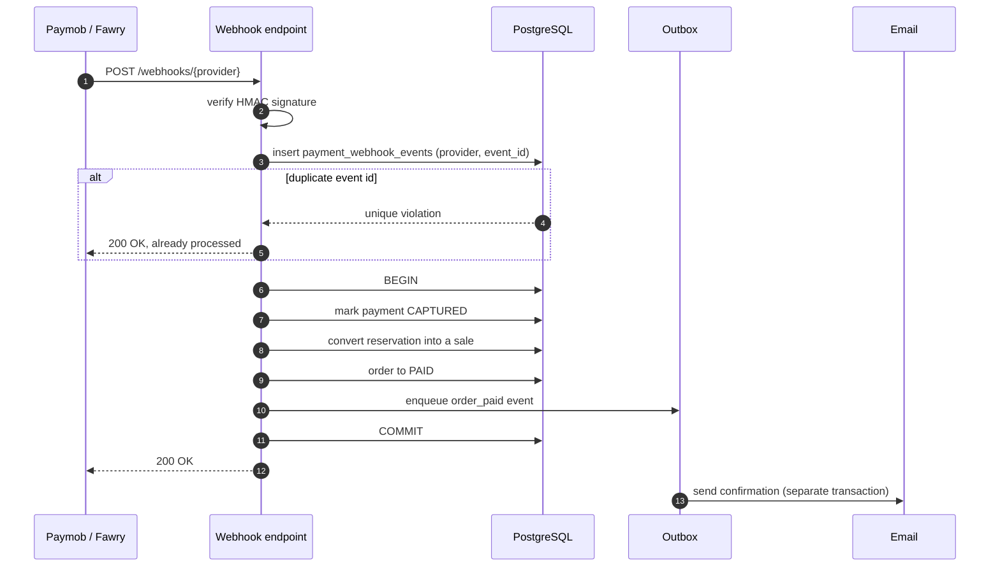

The event is stored before it is acted on, and the outbox is drained separately. An email provider
that is briefly down cannot roll back a payment that has already been captured.

### Order state machine

This mirrors `OrderStatus.allowedTransitions()` exactly.

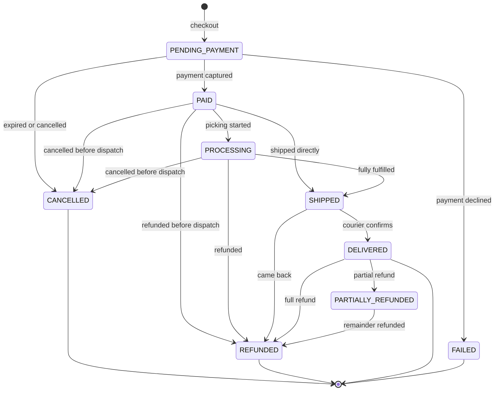

Illegal transitions are rejected with `409 INVALID_STATUS_TRANSITION`. A delivered order cannot go
back to processing. `DELIVERED`, `CANCELLED`, `REFUNDED` and `FAILED` are terminal; a customer may
cancel only from `PENDING_PAYMENT`, `PAID` or `PROCESSING`, since nothing that has left the warehouse
can be called back by a button.

A shipment that comes back is recorded as a refund on the order. The physical return has its own
approve and receive workflow on the `returns` table.

### Authentication and token refresh

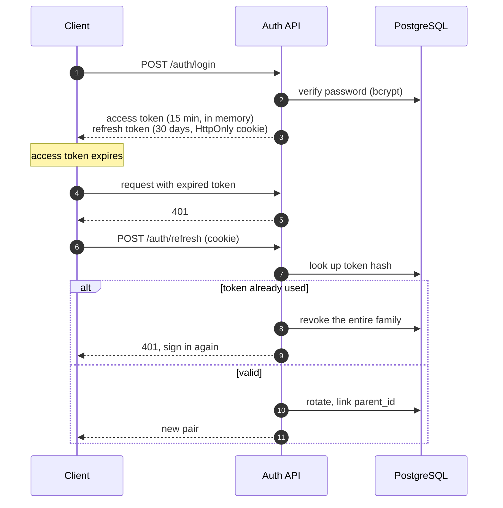

The access token lives in memory and the refresh token in an HttpOnly cookie. An XSS that reaches
the page gets at most a fifteen-minute token, not a thirty-day session.

On mobile there is no cookie jar, so the refresh token goes into the platform keychain, and refreshes
are serialised behind a lock. Without that lock, four concurrent 401s start four refreshes, three of
them present a token the first already rotated, and the backend correctly treats that as replay.

---

## Deployment topology

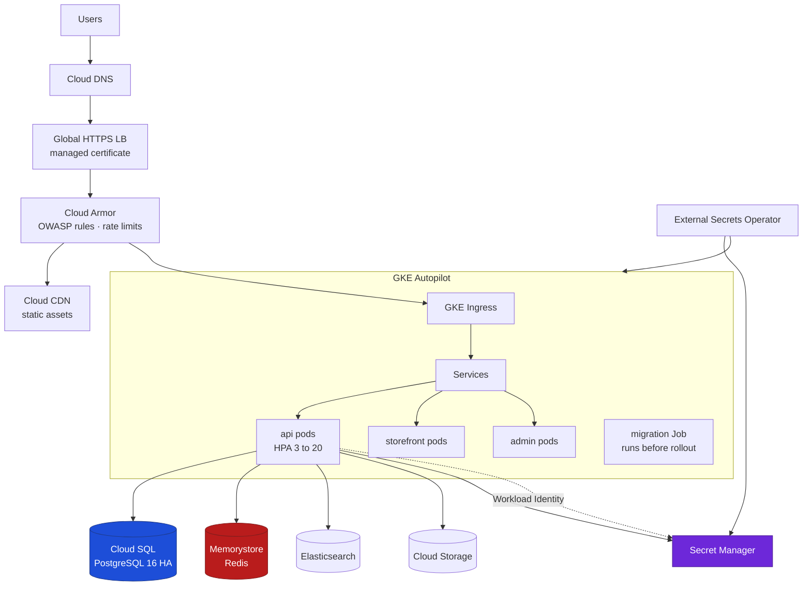

Secrets never appear in this repository, in a container image, or in a CI variable. They live in
Secret Manager, and workloads reach Google services through Workload Identity, so there is no
service-account key to leak.

---

## CI/CD pipeline

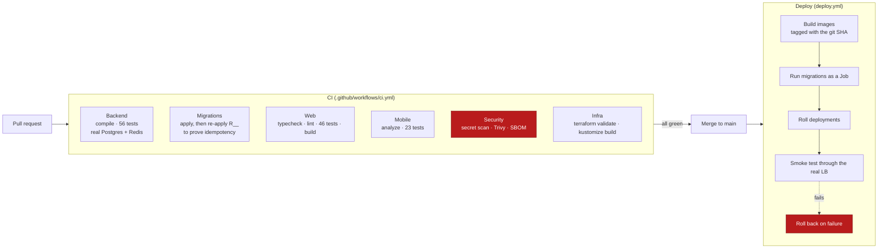

Images are tagged with the git SHA and never `latest`. A tag that moves makes a rollback ambiguous.

---

## Running it locally

Docker is the only prerequisite. No local JDK, Maven, Node, or Flutter install is needed.

```bash
git clone https://github.com/ahmedselimmansor-ctrl/Eshop-E-Comerce-NEXT.JS-Spring-Boot.git
cd Eshop-E-Comerce-NEXT.JS-Spring-Boot
cp .env.example .env
make dev
```

That starts PostgreSQL, Redis, Elasticsearch, Mailpit, a Cloud Storage emulator, and Jaeger. Then:

```bash
make api      # Spring Boot on :8080
make web      # storefront on :3000
make admin    # admin console on :3001
```

Or run everything in containers with `make up`.

| | |
|---|---|
| Storefront | http://localhost:3000 |
| Admin | http://localhost:3001 |
| API docs | http://localhost:8080/swagger-ui.html |
| Mail | http://localhost:8025 (every outbound email lands here) |
| Traces | http://localhost:16686 |

Under the `local` and `dev` profiles the API seeds a demo catalog on startup: five brands, a
two-level category tree, and eight products with stock. It includes a draft product the storefront
must hide, one item out of stock, and one below its reorder level, so the empty and error states are
reachable without setting anything up.

Payment providers are unconfigured by default, so local checkout uses cash on delivery, which needs
no gateway. Set the `PAYMOB_*` and `FAWRY_*` variables in `.env` to exercise the real flows against
their sandboxes.

---

## Layout
```
backend/          Spring Boot API, package per domain, enforced by ArchUnit
  ├── common/       errors, Money, UUIDv7, outbox, idempotency
  ├── security/     JWT, RBAC, rate limiting, password policy
  ├── catalog/      products, variants, categories, brands, attributes
  ├── inventory/    stock levels, movements ledger, reservations
  ├── cart/         guest and authenticated carts, merge on sign-in
  ├── promotion/    coupons and rule-driven promotions
  ├── order/        checkout, order state machine, shipments, returns
  ├── payment/      Paymob · Fawry · COD behind one provider interface
  ├── search/       Elasticsearch indexing and faceted query
  └── ...           media, notification, review, settings, admin

web/
  ├── packages/api-client/   Zod schemas and typed client, shared by both apps
  ├── apps/storefront/       customer facing, ar/en with full RTL
  └── apps/admin/            operations console

mobile/           Flutter client
infra/
  ├── terraform/    GCP infrastructure as code
  ├── k8s/          Kustomize base plus dev/staging/prod overlays
  └── docker/       multi-stage build files
docs/             architecture, data model, API contract, conventions
```

| | |
|---|---|
| [Architecture](docs/00-ARCHITECTURE.md) | System design, GCP topology, availability and security model |
| [Data model](docs/01-DATA-MODEL.md) | Every table, with the reasoning behind the shape |
| [API contract](docs/02-API-CONTRACT.md) | Endpoints, error codes, rate limits, permissions |
| [Conventions](docs/03-CONVENTIONS.md) | Pinned versions and the rules every module follows |

---

## Decisions worth knowing before reading the code

**Stock is reserved, never decremented, at checkout.** An order that is never paid must not destroy
inventory. Checkout takes a thirty-minute hold under `SELECT ... FOR UPDATE`; payment converts it to
a sale, and a sweeper releases anything abandoned. This is what stops a flash sale from being drained
by carts nobody intends to pay for.

**Prices are re-read from the catalog inside the checkout transaction.** The cart's stored prices are
a display cache. A price that moved since the item was added surfaces as `PRICE_CHANGED` and the
customer confirms. Never silently honoured, never silently raised.

**Checkout and refunds require an `Idempotency-Key`.** A customer on a flaky mobile connection taps
"Pay", the request succeeds, the response is lost, and the app retries. Without the key, that is two
orders and two charges.

**Payment webhooks are stored before they are acted on.** The unique `(provider, event_id)`
constraint is the idempotency mechanism. Providers retry aggressively, and processing a capture twice
would commit stock twice and send two confirmations.

**The access token lives in memory; the refresh token is an HttpOnly cookie.** An XSS that reaches
the page gets at most a fifteen-minute token, not a thirty-day session. Refresh tokens rotate on
every use, and replaying a spent one revokes the entire family.

**Elasticsearch returns ids, not documents.** Cards are hydrated from PostgreSQL, so a price edit is
visible immediately even while the index lags, and when the cluster is unavailable, listings fall
back to PostgreSQL rather than the storefront going down.

**Card data never touches this system.** Paymob's iframe and Fawry's hosted flow collect the PAN.
What is stored is a provider id, the brand, and the last four digits.

**Response mapping happens inside the transaction.** `open-in-view` is disabled. A controller that
maps an entity returned by a service is reading a detached proxy, which compiles cleanly and throws
on every call. Services return finished DTOs.

---

## Testing

```bash
make test          # backend, web and mobile
make test-backend  # 56 tests, needs `make infra` running
make test-web      # typecheck, lint, and 46 unit tests
make test-mobile   # flutter analyze and 23 tests
```

The backend suite runs against a real PostgreSQL and Redis rather than mocks, because the defects it
exists to catch are the ones a mock cannot see: a `jsonb` column rejecting a value, a lazy
association read after its session closed, a migration that does not apply. It creates and uses its
own `eshop_test` database, so a run never touches local working data.

ArchUnit enforces the layering rules described above. They are tests rather than documentation
because every one of them was written after the rule had already been broken somewhere.

---

## Common tasks

```bash
make dev               # start local infrastructure
make test              # every test suite
make typecheck         # web workspace only
make audit             # dependency vulnerabilities and SBOM
make db-shell          # psql against the local database
make db-reset          # drop, recreate, re-migrate
make db-repair         # realign Flyway checksums, runs no SQL
make reindex           # rebuild the Elasticsearch product index
make images            # build the container images
make k8s-diff ENV=prod # preview the rendered Kubernetes manifests
make tf-plan ENV=prod  # Terraform plan
make help              # everything else
```

---

## Deploying

Infrastructure first, then the application:

```bash
cd infra/terraform/envs/prod
cp terraform.tfvars.example terraform.tfvars   # fill in project id and authorised networks
terraform init && terraform apply
```

Then point DNS at the `ingress_ip` output, populate Secret Manager (the External Secrets Operator
projects the values into the cluster), and let CI deploy. `.github/workflows/deploy.yml` builds
images, runs migrations as a Job, rolls the deployments, smoke-tests through the real load balancer,
and rolls back on failure.

---

## Status

**Backend.** Complete and tested: migrations, security, catalog, inventory, cart, promotions,
checkout, orders, payments, search, media, notifications, and the admin API. Fifty-six tests,
covering the checkout and refund paths, the store rules that live in settings, the admin API, JSON
round-tripping, and the layering rules.

**Storefront.** The full purchase path in both languages with RTL: home, listing with facets, product
detail, cart, checkout, account, orders, and wishlist.

**Admin console.** Dashboard, orders with fulfilment and refunds, products with a create and edit
form, inventory, customers, review moderation, search health, and settings. Every action is gated on
the permission its endpoint enforces.

**Mobile.** The full purchase path: home, search with debounced queries and sorting, category
listing, product detail, cart, checkout, order detail, account, addresses, and sign-in with
registration. `flutter analyze` is clean and 23 tests cover the parsing and the order state logic.
Widget behaviour is unverified, since there is no emulator in this environment.

**Infrastructure.** Docker, Kustomize for three environments, Terraform for GCP, and CI/CD.

**Tests.** 125 in total: 56 backend, 46 web, 23 mobile. All three run in CI.

Known gaps: no end-to-end or component tests on the web (the unit tests cover the API contract, the
formatting helpers and the listing-parameter clamping, not rendering); the refund path has not been
exercised against a real captured payment, since a cash-on-delivery order has nothing to refund and
the API correctly rejects it.
